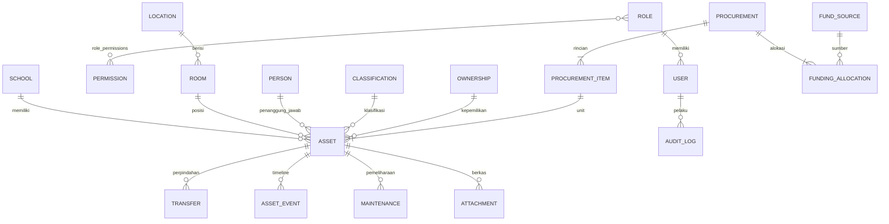

# Desain Sarprasku tahap pertama

Tanggal: 16 November 2026. Satu instalasi untuk satu sekolah, multi-user, PHP 8.3+, MySQL 8.0+, Laravel 12. Tidak ada registrasi publik atau modul siswa/persediaan. Ini pencatatan internal, bukan pengganti sistem pemerintah atau format resmi BMN.

## Pendekatan dan asumsi

Monolith Blade + Livewire + Tailwind dipilih agar mudah dihosting tanpa worker permanen. SPA/API terpisah menambah deployment dan permukaan autentikasi; layanan SaaS tidak sesuai kebutuhan satu sekolah. Keputusan teknis diselesaikan langsung sesuai mandat pengguna. Fortify menyediakan login/reset; permission disimpan sebagai pemetaan peran di database dan diperiksa Gate/Policy. Lingkup objek seluruh sekolah dalam instalasi ini, bukan pembatasan per ruang. Pegawai terpisah dari pengguna.

Nomor inventaris unik dalam sekolah; UUID tetap dan token QR acak terpisah. NUP disimpan teks, tidak diberi unique global karena cakupan resmi belum tersedia; operator wajib memverifikasi klasifikasi dan NUP dengan referensi sekolah. Kondisi dan status operasional terpisah. Data awal yang tidak diketahui tetap NULL dengan catatan belum diverifikasi. Tidak mengarang master klasifikasi resmi.

Pengadaan → rincian (kuantitas, harga unit) → unit aset. Alokasi sumber dana hanya pada pengadaan, tidak diduplikasi pada aset. Jumlah alokasi wajib sama persis total rincian menggunakan aritmetika sen/BCMath dan DECIMAL(18,2). Pengadaan final tidak diedit; koreksi melalui catatan/dokumen dan pengadaan baru yang diverifikasi operator.

Perpindahan: draft → submitted → approved/rejected/cancelled; draft juga dapat dibatalkan. Satu slot aktif unik per aset pada database, NULL setelah terminal. Pengajuan mengambil snapshot asal; persetujuan mengunci aset dan transaksi, memeriksa asal terkini, tanggal sekolah hari ini dan bukan pengaju sendiri. Perbarui posisi, timeline, audit dalam satu transaksi. Koreksi membuat transaksi baru merujuk transaksi disetujui; tidak menulis ulang histori. Semua perubahan posisi aset melalui service ini.

Lampiran privat JPEG/PNG/PDF dibatasi ukuran, MIME, nama acak dan diunduh melalui otorisasi. Tidak ada symlink public. QR hanya URL token; login + izin tetap wajib. Label A4 dengan ukuran dalam mm, PNG lokal, quiet zone, preview dan PDF. Audit terpisah dari timeline bisnis; database administrator masih dapat mengubah data.

## ERD

## Verifikasi dan batas hosting

Uji integrasi pada database MySQL terpisah, constraint unik dan konflik, rollback, matriks izin, nonaktif, eskalasi, unggahan, ekspor dan PDF. Pemeriksaan UI desktop/ponsel jika tersedia. Pemindaian cetak fisik harus dilakukan sekolah; pengujian digital tidak membuktikan hasil cetak fisik. Tidak ada deployment nyata tanpa kredensial/target hosting. Laravel 12 security-only sampai 24 Februari 2027; rencanakan evaluasi upgrade sebelum tenggat.
